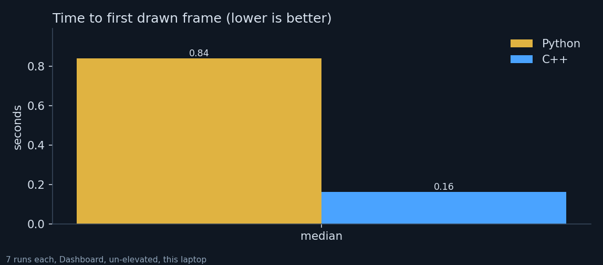
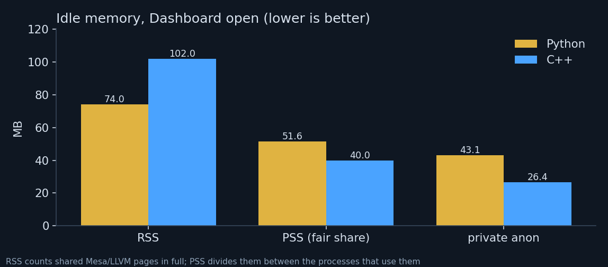
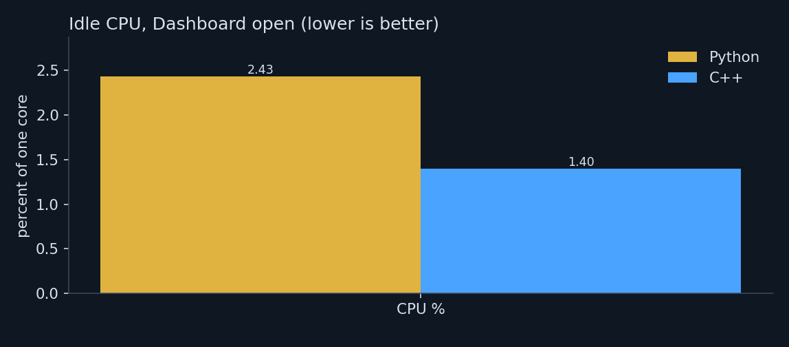
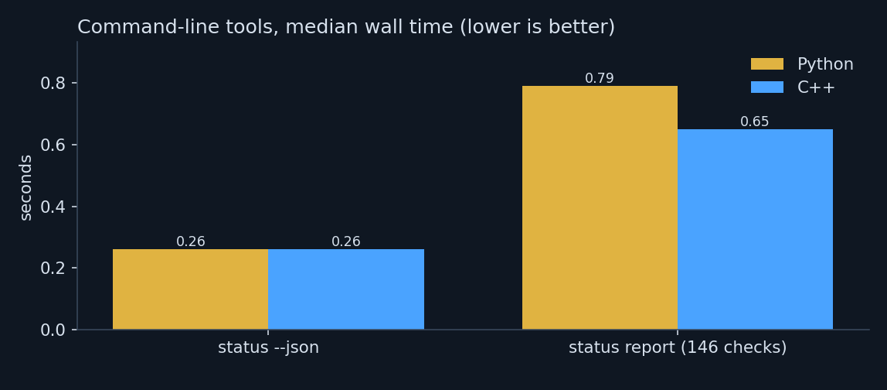
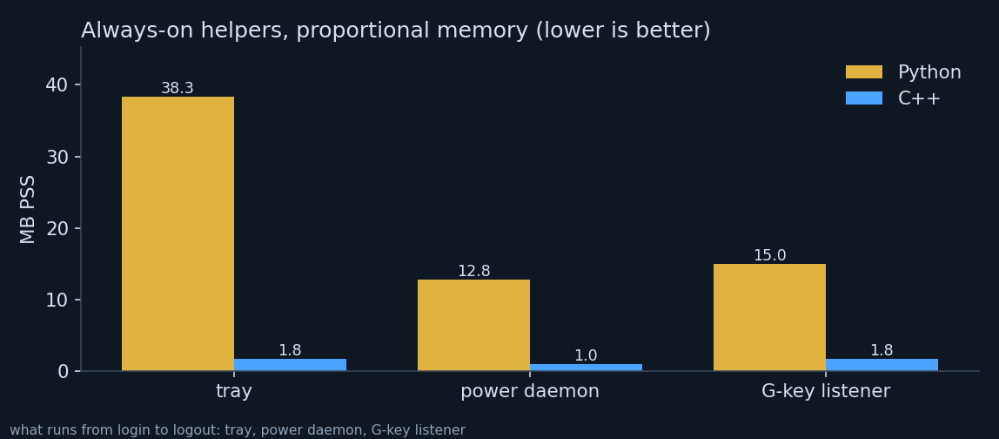

# Python edition vs C++ edition

Measured on this laptop by `cpp/scripts/compare-python-cpp.py` (raw numbers: `results.json`). Both GUIs run un-elevated on the Dashboard.

| | Python | C++ | change |
|---|---|---|---|
| First frame | 0.84 s | 0.162 s | 5.2x faster |
| Idle CPU (GUI) | 2.43 % | 1.40 % | -42% |
| Idle PSS (GUI) | 52 MB | 40 MB | -22% |
| Idle private memory (GUI) | 43 MB | 26 MB | -39% |
| Idle RSS (GUI) | 74 MB | 102 MB | +38% (shared Mesa pages) |
| Threads (GUI) | 2 | 14 |  |
| `status --json` | 0.26 s / 23 MB | 0.26 s / 23 MB | wall / peak RSS |
| `status report (146 checks)` | 0.79 s / 50 MB | 0.65 s / 34 MB | wall / peak RSS |
| Always-on: tray | 38.3 MB PSS | 1.8 MB PSS | -95% |
| Always-on: power daemon | 12.8 MB PSS | 1.0 MB PSS | -92% |
| Always-on: G-key listener | 15.0 MB PSS | 1.8 MB PSS | -88% |
| Always-on total | 66 MB PSS | 4.5 MB PSS | -93% |
| Runtime installed | python3 + Tk + ttkbootstrap + Pillow, 277 modules / 5.8 MB loaded at start, 1.1 MB source | 5.9 MB in 4 binaries | no interpreter, no pip packages |
| Code | 27,418 lines | 25,647 lines |  |
| Automated tests | 359 tests | 620 checks + launch smoke test |  |

